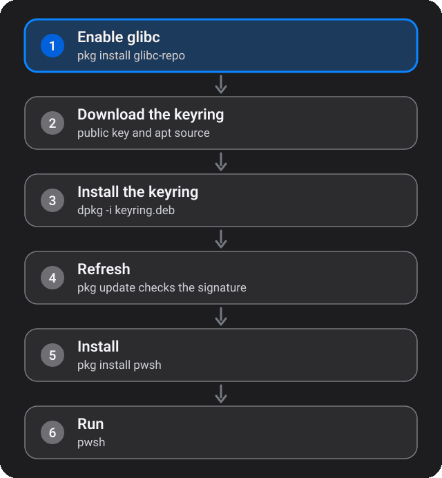
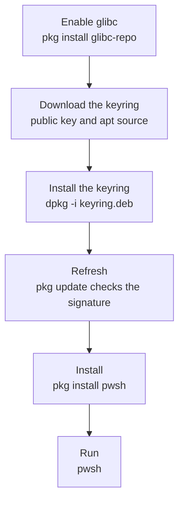

# Install pwsh-termux

Install PowerShell 7 on Termux with `pkg`. This page is for the command line; the [website install page](https://pwsh-termux.machlev.org/install.html) says the same.

1. [Before you start](#1-before-you-start)
2. [Set up the repository (once)](#2-set-up-the-repository-once)
3. [Stable: the regular install](#3-stable-the-regular-install)
4. [Preview: the optional early build](#4-preview-the-optional-early-build)
5. [Update](#5-update)
6. [Uninstall](#6-uninstall)
7. [Verify it yourself](#7-verify-it-yourself)
8. [Troubleshooting](#8-troubleshooting)
9. [Turn off Microsoft's telemetry](#9-turn-off-microsofts-telemetry)

## 1. Before you start

You need Termux on a 64-bit Arm phone (arm64, also written aarch64), about 200 MB of free space (the download is about 50 MB) and an internet connection. Check the architecture; it must print `aarch64`:

```bash
uname -m
```

32-bit Termux (`armv7l`, `armv8l`) and x86 devices cannot run these packages.

## 2. Set up the repository (once)

Do this one time. Stable and preview both need it.

This command enables Termux's glibc repository, downloads the keyring package, installs it and refreshes the package lists. The keyring holds the repository's public signing key and its apt source. `pkg` then checks every download against that key.

```bash
pkg install -y glibc-repo && \
curl -fsSL https://pwsh-termux.machlev.org/pwsh-termux-keyring.deb -o "$TMPDIR/pwsh-termux-keyring.deb" && \
dpkg -i "$TMPDIR/pwsh-termux-keyring.deb" && \
pkg update
```

The same steps as a picture. The animation lights up each step in turn.



<details>
<summary>Diagram source (Mermaid)</summary>



</details>

Prefer not to install a package for the key? [Add it by hand](https://pwsh-termux.machlev.org/install.html#by-hand). The manual steps include the glibc repository. A key added by hand is not updated by `pkg upgrade`.

## 3. Stable: the regular install

**Pick this unless you know you want the preview.** `pwsh` is the highest stable PowerShell 7 release. The command is `pwsh`.

```bash
pkg install pwsh
```

Start it and print its version:

```bash
pwsh
```

```powershell
$PSVersionTable.PSVersion
```

## 4. Preview: the optional early build

`pwsh-preview` is the newest preview or release candidate. Expect rough edges.

- It exists only while Microsoft's newest preview is newer than the newest stable release. When none qualifies, `pkg install pwsh-preview` fails with `Unable to locate package`.
- It installs next to `pwsh`, as its own command, and shares no files with it. You can have both.
- It never turns into stable. When the final release ships, preview builds of that version leave the repository; install `pwsh`.

See what is on offer now:

```bash
apt-cache policy pwsh pwsh-preview
```

Install and start it:

```bash
pkg install pwsh-preview
```

```bash
pwsh-preview
```

## 5. Update

`pkg upgrade` updates everything, including `pwsh`, `pwsh-preview` and the keyring.

```bash
pkg upgrade
```

The repository is re-signed every day even when nothing changed, so most days `pkg update` only fetches a small signature file. A new PowerShell version is picked up by the next daily run after Microsoft releases it.

To stay on an older build, see [pinning and downgrading](docs/markDown/product/packages.md#pinning-or-downgrading).

## 6. Uninstall

Remove PowerShell, then the key and the apt source. Remove `pwsh-preview` only if you installed it; apt stops with an error for a package it does not know.

```bash
pkg remove pwsh
pkg remove pwsh-preview    # only if installed
pkg remove pwsh-termux-keyring
pkg update
```

If you add the key by hand, also delete its two files:

```bash
rm "$PREFIX/share/keyrings/pwsh-termux-archive-keyring.gpg" "$PREFIX/etc/apt/sources.list.d/pwsh-termux.list"
```

Your profile and modules in `~/.config/powershell` and `~/.local/share/powershell` stay. Delete them for a clean slate.

## 7. Verify it yourself

Optional. Each check uses a different channel, so a mismatch is a warning sign.

**The signing keys.** Print the fingerprints of the installed keyring and compare them with these and with [SECURITY.md](SECURITY.md#signing-key):

```bash
pkg install gnupg
gpg --show-keys "$PREFIX/share/keyrings/pwsh-termux-archive-keyring.gpg"
```

```text
7086 C70B 4A25 576F E0C0  CE77 E43F B41F 02D0 1FC8   signing key
937A 3D41 5103 CFF8 9DCD  A982 A4B4 5397 EEB6 D752   recovery key
```

**Where the packages were built.** Every `.deb` has signed build provenance from this project's build workflow. With the GitHub CLI (`pkg install gh`, signed in):

```bash
gh attestation verify "$TMPDIR/pwsh-termux-keyring.deb" \
  --repo EliorMachlev/pwsh-termux \
  --signer-workflow EliorMachlev/pwsh-termux/.github/workflows/build-packages.yaml \
  --deny-self-hosted-runners
```

**The signed index.** `pkg` does this on every update. To do it by hand:

```bash
curl -fsSL https://pwsh-termux.machlev.org/dists/stable/InRelease -o "$TMPDIR/InRelease"
gpgv --keyring "$PREFIX/share/keyrings/pwsh-termux-archive-keyring.gpg" "$TMPDIR/InRelease"
grep -E '^(Date|Valid-Until):' "$TMPDIR/InRelease"
```

`Valid-Until` is 14 days after `Date`. If the signing key changes, `pkg upgrade` delivers the new keyring (a planned rotation overlaps by 180 days). See [key rotation and recovery](SECURITY.md#rotation-and-recovery).

## 8. Troubleshooting

- **`NO_PUBKEY`, or the repository is "not signed".** The key is missing, empty or outdated. Run the step-2 command again. For a key added by hand, download it again.
- **`Unable to locate package pwsh`.** The keyring is not installed, or `pkg update` has not run since. Repeat step 2.
- **`Unable to locate package pwsh-preview`.** No preview is newer than stable right now. That is normal; see [step 4](#4-preview-the-optional-early-build).
- **`depends on glibc, but it is not installable`.** The glibc repository is off. Run `pkg install glibc-repo`, then `pkg update`.
- **`Unable to locate package glibc-repo`.** Termux's package lists are old. Run `pkg update` (or `termux-change-repo`) and repeat step 2.
- **`package architecture (aarch64) does not match system`, or no installation candidate.** The device is not arm64. Use the check in [step 1](#1-before-you-start).
- **"Release file … is expired".** The signed index was not renewed within 14 days, or your phone's clock is far ahead. Check the date in Android's settings; otherwise it clears at the next daily re-sign. PowerShell keeps working meanwhile.
- **"Release file … is not valid yet".** Your phone's clock is behind. Set date and time automatically.
- **`pwsh` will not start, or a library is missing.** Reinstall, and if that fails, [open an issue](https://github.com/EliorMachlev/pwsh-termux/issues) with the output of the second command:

```bash
pkg install --reinstall pwsh
pkg list-installed | grep -E 'glibc|icu|pwsh'
```

## 9. Turn off Microsoft's telemetry

This project does not change PowerShell. Microsoft's build sends usage telemetry unless you opt out, and it can print a notice about newer versions. To turn both off, append this to `~/.bashrc` (or your shell's startup file) and export them in the current shell, which does not re-read that file:

```bash
echo 'export POWERSHELL_TELEMETRY_OPTOUT=1' >> ~/.bashrc
echo 'export POWERSHELL_UPDATECHECK=Off' >> ~/.bashrc
export POWERSHELL_TELEMETRY_OPTOUT=1
export POWERSHELL_UPDATECHECK=Off
```

Back to the [README](README.md).
