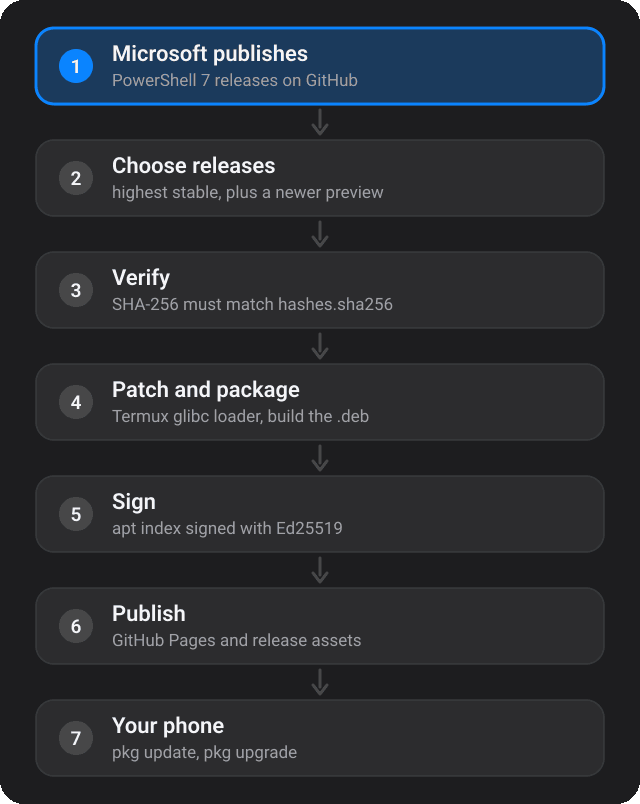
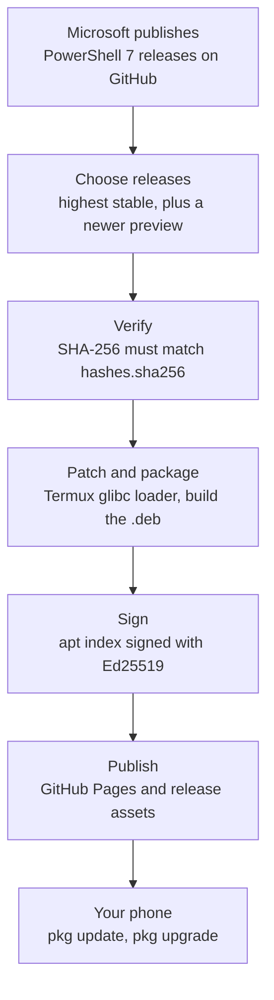

<div align="center">

<a href="https://pwsh-termux.machlev.org/">
  <picture>
    <source media="(prefers-color-scheme: dark)" srcset="art/brand/mark-dark.svg">
    
  </picture>
</a>

# pwsh-termux

**PowerShell 7 for Termux, installed with `pkg`.**

[](https://github.com/EliorMachlev/pwsh-termux/releases)
[](https://github.com/EliorMachlev/pwsh-termux/actions/workflows/update.yaml)
[](https://github.com/EliorMachlev/pwsh-termux/actions/workflows/ci.yaml)
[](https://securityscorecards.dev/viewer/?uri=github.com/EliorMachlev/pwsh-termux)
[](LICENSE)

**[Website](https://pwsh-termux.machlev.org/)** · [Install guide](INSTALL.md) · [Releases](https://github.com/EliorMachlev/pwsh-termux/releases) · [Docs](docs/markDown/README.md)

</div>

---

## What is this?

Termux does not ship PowerShell. This project is an unofficial apt (Advanced Package Tool) repository that fills the gap: it takes Microsoft's official PowerShell 7 release, checks it, makes it run on Termux, signs it and keeps it up to date. You add the repository once; after that `pkg install pwsh` and `pkg upgrade` work like for any other package.

It is not affiliated with Microsoft. Microsoft's files ship unchanged apart from two ELF headers ([NOTICE.md](NOTICE.md)).

## Quick start

You need Termux on an **arm64 (aarch64)** phone. Copy and run:

```bash
pkg install -y glibc-repo && \
curl -fsSL https://pwsh-termux.machlev.org/pwsh-termux-keyring.deb -o "$TMPDIR/pwsh-termux-keyring.deb" && \
dpkg -i "$TMPDIR/pwsh-termux-keyring.deb" && \
pkg update && \
pkg install pwsh
```

Then start it:

```bash
pwsh
```

That is the **stable** release, which is what you want. There is also an optional **preview** channel (`pwsh-preview`). Both are covered, with updating, uninstalling, verifying and troubleshooting, in the **[install guide](INSTALL.md)**.

## Stable or preview?

1. **`pwsh`**: the highest stable PowerShell 7 release. Command: `pwsh`.
2. **`pwsh-preview`**: the highest preview or release candidate, only while it is newer than stable. Command: `pwsh-preview`. It installs next to `pwsh`.

A third package, `pwsh-termux-keyring`, holds the public signing key and the apt source. The quick start installs it. Details: [packages](docs/markDown/product/packages.md).

## How it works

A daily GitHub Actions run follows Microsoft's releases. The picture shows one run. The animation lights up each step in turn.



<details>
<summary>Diagram source (Mermaid)</summary>



</details>

1. **Follows Microsoft.** The highest stable release becomes `pwsh`; while a newer preview or release candidate exists, it becomes `pwsh-preview`. Releases are chosen by version, not date, because Microsoft backports patches to older lines.
2. **Verified.** Each tarball must match the SHA-256 (a 256-bit hash) in Microsoft's `hashes.sha256` before anything is built from it.
3. **Signed.** apt verifies the index's Ed25519 (a digital signature algorithm) signature on every `pkg update` ([fingerprint](SECURITY.md#signing-key)).
4. **Native.** The glibc (the GNU C library) binary is patched at build time to use Termux's glibc loader: no proot, no `glibc-runner` ([why](docs/markDown/engineering/architecture/packaging.md#why-patchelf-and-not-glibc-runner)).
5. **Archived.** Every built `.deb` stays as a GitHub release asset, with a CycloneDX and three SPDX (Software Package Data Exchange) SBOMs (software bills of materials) and signed build provenance ([verify](SECURITY.md#software-bill-of-materials-sbom-and-build-provenance)).

The pipeline is [`update.yaml`](.github/workflows/update.yaml); [architecture](docs/markDown/engineering/architecture/README.md) explains each stage.

## Good to know

- **arm64 only**, on Termux with the glibc repository.
- **Only the current stable and preview are in the repository.** Older builds are release assets ([pinning](docs/markDown/product/packages.md#pinning-or-downgrading)).
- **PowerShell is unchanged**, including Microsoft's telemetry and update notice. The [install guide](INSTALL.md#9-turn-off-microsofts-telemetry) shows how to switch them off.
- **The signed index is valid for 14 days** and re-signed daily. If the pipeline broke for longer, `pkg update` reports the Release file as *expired* rather than serve stale packages ([why](SECURITY.md#index-freshness-valid-until)).

## Learn more

- [Documentation index](docs/markDown/README.md): architecture, build, release, CI (continuous integration) / CD, security.
- [Contributing](CONTRIBUTING.md): bug fixes are welcome; for new features, open an issue first. Every pull request must pass 22 required checks ([CI / CD](docs/markDown/engineering/ci-cd.md)).
- [Security policy](SECURITY.md): report vulnerabilities privately.
- Legal: [Privacy](docs/markDown/legal/privacy-policy.md) · [Terms](docs/markDown/legal/terms-of-service.md) · [Accessibility](docs/markDown/legal/accessibility-statement.md) · [Compliance](docs/markDown/legal/compliance-posture.md)

## License

PowerShell © Microsoft Corporation, MIT; what the packaging changes is in [NOTICE.md](NOTICE.md). "PowerShell" is a trademark of Microsoft; this project is not affiliated with or endorsed by Microsoft. Packaging scripts © pwsh-termux contributors, [MIT](LICENSE).
